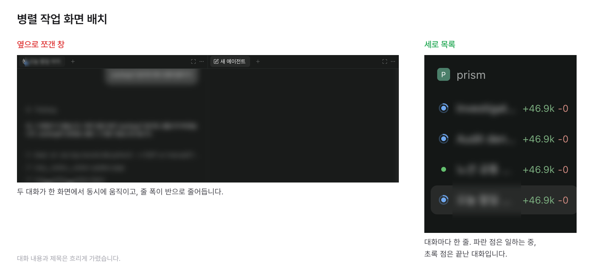
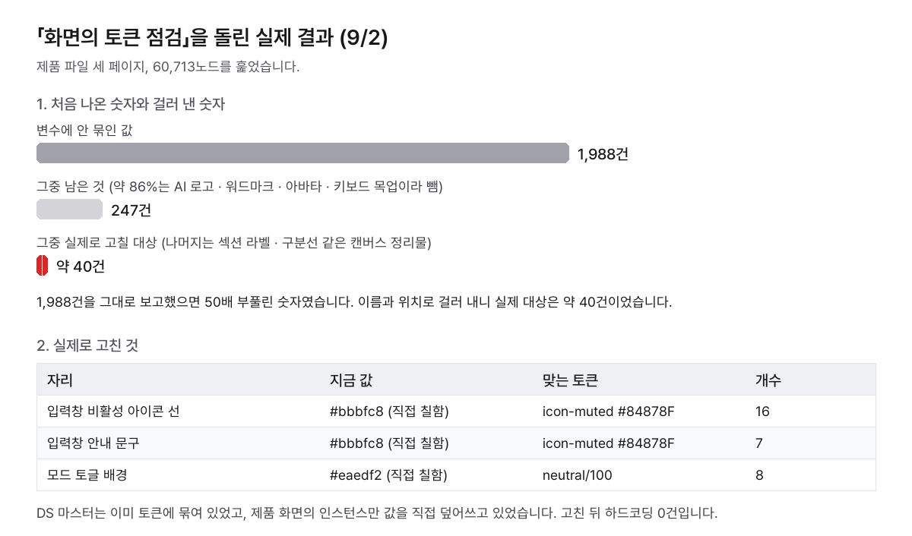

# [27] 부록. 바로 붙여 넣는 지시어

> 구분: 운영 · 영역: 공통

## 언제 쓰나

21~26장의 프롬프트를 상황별로 한 장에 모은 빠른 판입니다. 왼쪽 칸에서 상황을 찾고 오른쪽 문장을 그대로 복사해서 씁니다. 범위와 확인 방법까지 필요하면 해당 장으로 갑니다. 원래 매일 쓰던 말을 바탕으로, 범위와 멈출 자리를 넣어 다시 다듬었습니다(2026-10-13).

## 이렇게 시킨다

### 하루 흐름

worklog를 안 쓰면 오른쪽 열의 말을 씁니다.

| 언제 | 붙여 넣을 말 | worklog가 없다면 |
|---|---|---|
| 시작할 때 | 오늘 worklog에서 아직 안 끝난 일을 찾아 목록으로 보여 줘. 내가 고르기 전에는 시작하지 마. | 어제까지 하던 일 중 아직 안 끝난 것을 [노션 TODO · 메모 등]에서 찾아 목록으로 보여 줘. 내가 고르기 전에는 시작하지 마. |
| 일을 나눌 때 | 이 작업을 서로 겹치지 않게 나눠서, 에이전트마다 보낼 프롬프트를 만들어 줘. 프롬프트마다 범위와 끝나는 조건을 적어. | 같음 |
| 맥락이 흐려질 때 (다음 날로 이어졌거나 헷갈릴 때) | 처음에 맡은 일, 이미 끝난 일, 남은 일을 셋으로 나눠서 보여 줘. | 같음 |
| 기록이 오래됐을 수 있을 때 | 적어 둔 기록 말고 지금 상태를 다시 재서 말해 줘. 언제 잰 건지도 같이 적어. | 같음 |
| 선택지가 많을 때 | 할 일을 한 번에 하나씩 꺼내 줘. 하나가 끝나면 다음 걸 물어봐. | 같음 |
| 고민될 때 | 고를 수 있는 안을 두세 개로 나눠서 장단점과 네 추천 하나를 보여 줘. 내가 고르기 전에는 진행하지 마. | 같음 |
| 범위를 넘을 것 같을 때 | 처음 시킨 일 밖의 일, 지우거나 되돌리는 일은 하기 전에 물어봐. 끝낼지도 내가 정할게. | 같음 |
| 이해가 안 될 때 | 방금 내용을 쉬운 말로 다시 설명하고, 비교할 수 있게 그림이나 표로 보여 줘. | 같음 |
| 답이 길 때 | 결론부터 세 줄 안으로 말해 줘. 자세한 건 내가 물어보면 그때. | 같음 |
| 뭔가 안 될 때 | 고치기 전에 원인부터 재 줘. 캐시 · 권한 · 배포 지연처럼 코드가 아닌 원인도 먼저 확인하고, 추측으로 고치지 마. | 같음 |
| 결론이 미심쩍을 때 | 방금 결론의 근거를 파일이나 화면으로 보여 줘. 직접 확인 안 한 부분이 있으면 그렇다고 말해. | 같음 |
| 같은 실수를 짚었을 때 | 다음에 같은 실수를 안 하게 기억해 줘. 어디에 적었는지도 알려 줘. | 같음 |
| 만든 걸 확인할 때 | 만든 결과를 링크나 캡처로 바로 열어 볼 수 있게 보여 줘. 내가 보기 전에는 끝났다고 하지 마. | 같음 |
| 내가 손으로 하고 왔을 때 | 방금 [게시 / 로그인 / 승인]하고 왔어. 실제로 반영됐는지 네가 직접 확인하고 다음 단계로 가. | 같음 |
| 밖으로 보내기 전에 | 슬랙 · 이슈 · 메일처럼 남이 보는 곳에 올리는 건 보내기 전에 문구를 먼저 보여 주고 내 확인을 받아. | 같음 |
| 마무리할 때 (다른 이슈가 생겼을 때) | 처음에 맡은 일이 다 끝났으면 worklog를 남기고 멈춰. 다른 일이 생겼으면 네가 이어서 할지 다른 에이전트에 넘길지 이유와 함께 제안해 줘. | 처음에 맡은 일이 다 끝났으면 한 일과 남은 일을 짧게 정리해 주고 멈춰. 다른 일이 생겼으면 네가 이어서 할지 다른 에이전트에 넘길지 이유와 함께 제안해 줘. |
| 다 했는지 확인할 때 | 처음 요청과 비교해서 피그마 · 스토리북 · 코드 · 커밋 · PR · 머지 · 배포 · worklog 중 끝난 것과 안 끝난 것을 표로 보여 줘. 안 끝난 건 이유도 적어. | 처음 요청에 들어 있던 일 중 끝난 것과 안 끝난 것을 표로 보여 줘. 안 끝난 건 이유도 적어. |

> **💡 팁: 병렬로 나눈 일은 대화를 따로 열어 왼쪽 목록에 세로로 둡니다.**
>
> | | 옆으로 쪼갠 창 | 세로 목록 |
> |---|---|---|
> | 화면 | 두 대화가 동시에 움직여 한쪽을 읽는 동안 다른 쪽이 눈에 걸립니다 | 지금 보는 대화 하나만 화면을 씁니다 |
> | 줄 폭 | 반으로 줄어 답이 길어지고 표가 찌그러집니다 | 화면 폭을 다 씁니다 |
> | 진행 확인 | 내용을 직접 봐야 압니다 | 제목과 상태 점으로 한눈에 봅니다 |

### 디자인 시스템 점검

Claude에 피그마 MCP를 연결해 두면 AI가 피그마 파일을 직접 읽고 고칩니다.

**피그마만 있을 때**

| 무엇을 | 붙여 넣을 말 |
|---|---|
| DS 안 토큰 점검 | 디자인 시스템 컴포넌트를 전부 훑어서 변수나 스타일에 묶이지 않은 색 · 텍스트 스타일 · 라운드 · 선 두께를 찾아 표로 보여 줘. 고치기 전에 멈춰. |
| 화면 → DS | 디자인 화면에서 반복해 나오는 요소를 찾아 컴포넌트 후보로 보여 줘. 내가 고른 것만 DS에 만들고 화면의 원래 자리를 그 컴포넌트로 바꿔. |
| 화면의 토큰 점검 | 디자인 화면에서 토큰을 안 쓴 값을 찾아 줘. 그 값이 컴포넌트 안에 있으면 화면 말고 DS 컴포넌트를 고쳐. |

**스토리북·코드 패키지도 있을 때**

| 무엇을 | 붙여 넣을 말 |
|---|---|
| DS → 스토리북 | 스토리북에 아직 안 올라간 DS 컴포넌트 중 올릴 만한 것과, 올라가 있지만 내려도 될 것을 나눠서 보여 줘. 정한 대로 옮긴 뒤 피그마 안 위치도 그 구분에 맞춰 정리해. |
| DS ↔ 코드 | DS와 코드가 다른 곳을 찾아 그림과 함께 보여 줘. 어느 쪽으로 맞출지는 내가 정할 테니 묻기 전에 고치지 마. |
| 배포 | 끝난 작업을 충돌 없이 PR로 올리고 머지해 줘. 확정된 변경만 패키지로 배포해. |

## Source Worklog

- 정본: ax-log-records `manual/27-appendix-paste-prompts.md` (비공개, 2026-10-13 판)
- 원본: 노션 「프롬프트 지시어 정리」(10/8까지 디자이너 TODO에 모아 둔 지시어)
- 관련 경험 기록: 27편 AI가 반복하는 실수를 고친 방안들
